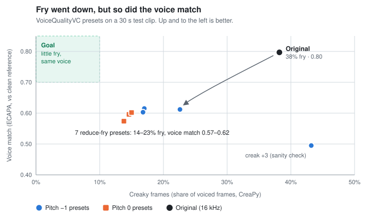

<h1 align="center">vocal-unfryer</h1>

<p align="center">
  <b>Listen to videos with less vocal fry, in the speaker's own voice.</b><br>
  No transcription, no AI re-voicing: the original audio is processed directly.
</p>

<p align="center">
  
  
  
  <a href="LICENSE"></a>
</p>

---

**Vocal fry** (creaky voice) is a low, crackling voicing mode that many listeners find tiring. Noise reduction and EQ can't remove it, because it isn't added noise: it's how the voice is produced. No dedicated tool for it exists, so this repo tries to build one.

The goal is a tool that takes a video, lowers the fry by an adjustable amount, and gives back audio that is the same length, stays in sync with the picture, and still sounds like the same person. The full brief is in [ROADMAP.md](ROADMAP.md).

> [!NOTE]
> **Paused since 2026-10-22.** The first experiment, running the research model VoiceQualityVC, reduced fry but changed the speaker's voice too much. The next step is to edit the original signal instead of regenerating it (see [Next direction](#next-direction)).

## Contents

- [Progress](#progress)
- [Experiment 1: VoiceQualityVC (rejected)](#experiment-1-voicequalityvc-rejected)
- [Next direction](#next-direction)
- [Setup](#setup)
- [Scripts](#scripts)
- [Repository layout](#repository-layout)

## Progress

| Phase (from [ROADMAP.md](ROADMAP.md)) | State | What exists |
|---|---|---|
| 0. Detect creak | Mostly done | CreaPy-based creak percentage per clip, most/least creaky 30 s windows, main-speaker filtering |
| 1. Signal-processing fix | Next | Not started |
| 2. Neural resynthesis | Tried off-the-shelf | VoiceQualityVC tested and rejected (below) |
| 3. Dedicated fry-to-clear model | Not started | |
| 4. Packaging (CLI, UI) | Not started | A/B listening page generator only |
| 5. Evaluation | Mostly done | Creak rate, voice match, Whisper WER, quality estimate, sync check |

## Experiment 1: VoiceQualityVC (rejected)

[VoiceQualityVC](https://github.com/Hfkml/VQVC) (KTH, Interspeech 2025) is a FreeVC-based voice converter with per-frame controls for creak, CPPS, H1–H2, H1–A3, pitch level and pitch variation. It was the closest existing tool to a fry remover.

<p align="center">
  
</p>

**Test clip:** Chris Liepe, ["STOP Using FRY (like this) I'm Begging You!"](https://www.youtube.com/watch?v=7rcstTklOHg), 2:15–2:45: a male speaker deliberately demonstrating fry. `pick_clip.py` chose it as the most creaky 30 s that contains only the video's main speaker. The speaker reference was 5:35–6:05 of the same video, the least creaky 30 s.

| Version | Creaky frames | Median pitch | Voice match | Word differences | Quality estimate |
|---|---:|---:|---:|---:|---:|
| **Original (16 kHz)** | **38.2%** | **116 Hz** | **0.80** | — | **2.93** |
| Pitch −1, creak 0 | 22.6% | 108 Hz | 0.61 | 1.3% | 3.55 |
| Pitch −1, creak −1 | 17.0% | 115 Hz | 0.62 | 2.5% | 3.65 |
| Pitch −1, creak −2 | 16.8% | 125 Hz | 0.60 | 5.1% | 3.75 |
| Pitch −1, creak +3 (sanity check) | 43.2% | 107 Hz | 0.50 | 2.5% | 3.74 |
| Pitch 0, creak 0 | 14.6% | 130 Hz | 0.60 | 0.0% | 3.65 |
| Pitch 0, creak −1 | 15.0% | 141 Hz | 0.60 | 3.8% | 3.73 |
| Pitch 0, creak −2 | 13.8% | 151 Hz | 0.57 | 3.8% | 3.63 |

<details>
<summary>How each column is measured</summary>

- **Creaky frames:** [CreaPy](https://gitlab.tugraz.at/speech/creapy) detections as a share of voiced frames (male model).
- **Voice match:** ECAPA cosine similarity to the clean reference window. For scale, a different speaker scores 0.15.
- **Word differences:** Whisper `small.en` transcript of each version, scored against the original's as WER.
- **Quality estimate:** torchaudio SQUIM's reference-free PESQ estimate. It treats fry as distortion, so it is not a naturalness score.

Raw numbers are in [results/](results/). The test audio is not included because it comes from someone else's video.
</details>

**What worked**
- Fry dropped by about half or more, and the creak control moved fry in the expected direction.
- Length and sync: the model returns exactly one 20 ms frame less than the input, and padding restores the exact length (also after resampling to 48 kHz). Sync measured within 10 ms at the start and end.

**Why it was rejected:** after listening, the voice changed dramatically. The cause is the whole-utterance resynthesis:
- The voice identity comes from a speaker embedding, not from the original audio.
- Intonation is regenerated from a single pitch-level setting.
- Output is 16 kHz.

## Next direction

Edit the original signal instead of regenerating it, so the speaker's own timbre stays (roadmap Phase 1):

1. Detect creaky regions with CreaPy (already wired up in `scripts/fry_metrics.py`).
2. Raise and smooth the pitch only inside those regions, resynthesize with WORLD or PSOLA, and leave everything else untouched.
3. Test on real conversational fry from the target videos, not demonstration fry.

## Setup

Tested on Windows 11 with Python 3.11 and Git Bash.

```bash
py -3.11 -m venv .venv
.venv/Scripts/python.exe -m pip install -r requirements.txt
bash setup.sh
```

`setup.sh` clones VQVC at the tested commit and applies the fixes it needs. It also downloads the VQVC checkpoint (~440 MB) and WavLM-Large (~1.26 GB).

<details>
<summary>Setup quirks found along the way</summary>

- **Missing WavLM code:** VQVC imports `wavlm/` but `.gitignore`s it. `setup.sh` fetches `WavLM.py` and `modules.py` from [microsoft/unilm](https://github.com/microsoft/unilm/tree/master/wavlm) and makes the import package-relative, so it doesn't collide with VQVC's own `modules.py`.
- **Missing `hifigan`:** VQVC's `utils.py` imports `hifigan` (not shipped) and `torchvision`; neither is used for inference. `vqvc_convert.py` stubs both and resets the DEBUG logging that `utils.py` turns on.
- **Dead WavLM link:** Microsoft's Azure link for WavLM-Large returns an auth error, and the Google Drive copy downloads very slowly. The [s3prl mirror](https://huggingface.co/s3prl/converted_ckpts) has the same `{cfg, model}` format and loads strictly into Microsoft's code. Its sha256 was `6fb4b3c3e6aa567f0a997b30855859cb81528ee8078802af439f7b2da0bf100f`; it was not compared against Microsoft's original.
- **CreaPy pins:** CreaPy needs `pandas<3` and `ruamel.yaml` 0.17.x (`safe_load` was removed in 0.18).
- **CPU-only torch:** installing SpeechBrain replaced the CUDA build of torch with the CPU-only PyPI build, so all results above were produced on CPU, about a minute for four presets including model loading. For GPU use, install CUDA builds of `torch`/`torchaudio` from the PyTorch index that satisfy SpeechBrain's requirement.
</details>

## Scripts

All scripts run from `scripts/` with the venv's Python.

| Script | What it does |
|---|---|
| `fry_metrics.py` | Shared helpers: ffmpeg conversion (bundled with `imageio-ffmpeg`) and CreaPy creak percentage |
| `scan_videos.py <dir>` | For each `.m4a` in a folder, the most and least creaky 30 s windows |
| `pick_clip.py <wav>...` | Same, restricted to each video's main speaker (ECAPA clustering of 5 s chunks) |
| `check_speaker.py <ref> <wav>...` | Speaker similarity of 5 s chunks to a reference |
| `vqvc_convert.py <src> <ref> <outdir> --pitch -1` | Runs VQVC presets, pads outputs to the exact input length |
| `evaluate.py <orig> <ref> <other> <outdir> --gender male` | Creak %, median pitch, voice match, WER, quality estimate, sync |
| `make_ab_page.py <clips> <outdir>...` | Self-contained A/B listening page with embedded FLAC audio |

Download test audio with `yt-dlp -f "bestaudio[ext=m4a]/bestaudio" -o "%(id)s.%(ext)s" <url>`. Downloading from YouTube may conflict with its terms, so keep it to personal use.

## Repository layout

```
ROADMAP.md        original project brief and phases
setup.sh          VQVC clone, fixes and model downloads
requirements.txt  exact versions behind the results
scripts/          detection, conversion, evaluation and A/B tools
results/          evaluation JSON for each pitch setting
docs/             README chart
```

## License

[GPL-3.0](LICENSE)
